# DashboardDP

A customizable browser dashboard for bookmarks, workspaces, tasks, calendars, and widgets. DashboardDP runs locally in desktop Brave, Chrome, and Edge, with no DashboardDP account required. Firefox is not supported by this distribution.

## Get started

1. Download `DashboardDP-1.11.5.zip` from the [latest release](https://github.com/PraenaDP/DashboardDP/releases/latest) and extract it to a permanent folder.
2. Open `brave://extensions`, `chrome://extensions`, or `edge://extensions`.
3. Turn on **Developer mode**, select **Load unpacked**, and choose the folder containing `manifest.json`.
4. Open a new tab and choose whether to import your browser bookmarks.

**Updating?** Download a full backup from **Settings → Data** first. Close dashboard tabs, replace the extension files in the same folder, and select **Reload** on the browser's extensions page. Do not uninstall the extension to update. See the [installation and recovery manual](docs/MANUAL_INSTALACION.md) for details.

## What you can do

- Organize bookmarks in folders, pin shortcuts, group related links, and open sets of tabs as workspaces.
- Use the browser side panel for pinned bookmarks, groups, and workspaces without replacing the page you are viewing. Choose an icon, list, or card view.
- Manage local projects, Kanban tasks, notes, and calendars. Google Calendar, Microsoft 365, and country holidays are optional integrations.
- Browse 1,309 public widgets, including 129 PhET references. Preview tools on demand, change types in bulk, and add widgets to up to nine dashboard sidebars.
- Import widgets from public repositories, resume an interrupted scan, and review duplicates before adding them.
- Audit bookmark availability, correct broken links, and verify individual changes.
- Choose light or dark themes, a background, and a locally installed font. The extension and built-in help are available in English and Spanish.

## Documentation

- [User guide](docs/USER_GUIDE.md)
- [Installation, updates, and recovery](docs/MANUAL_INSTALACION.md)
- [Calendar integrations](INTEGRACIONES_CALENDARIO.md)
- [Privacy](PRIVACIDAD.md), [security](SECURITY.md), and [release validation](docs/VALIDACION_1.11.5.md)
- [Changelog](CHANGELOG.md) and [third-party notices](THIRD-PARTY-NOTICES.md)

Inside the extension, open **Settings → Help** for searchable step-by-step articles.

## Screenshots

View more screenshots

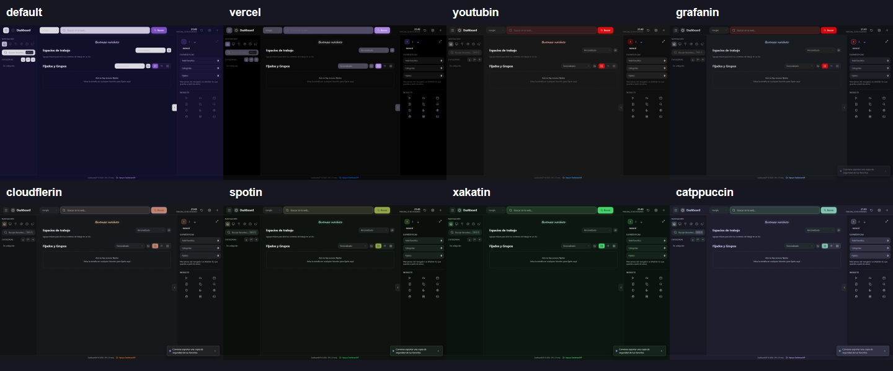
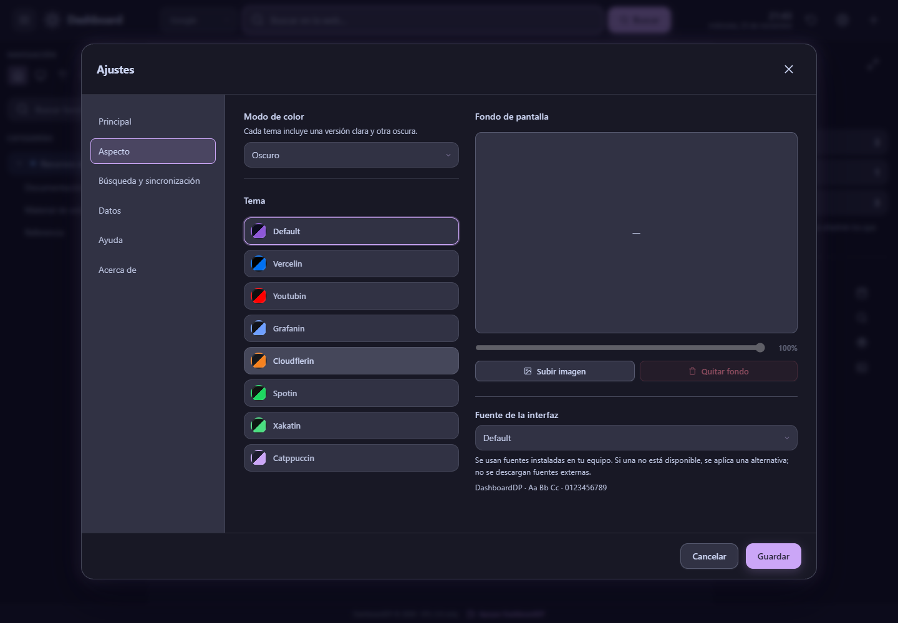

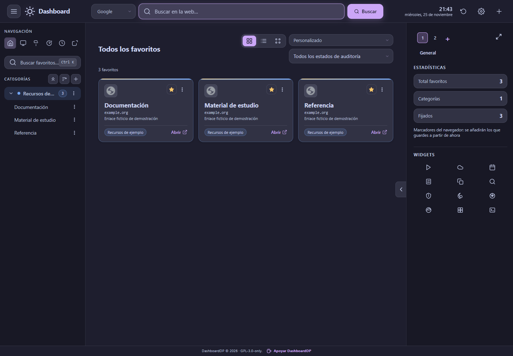
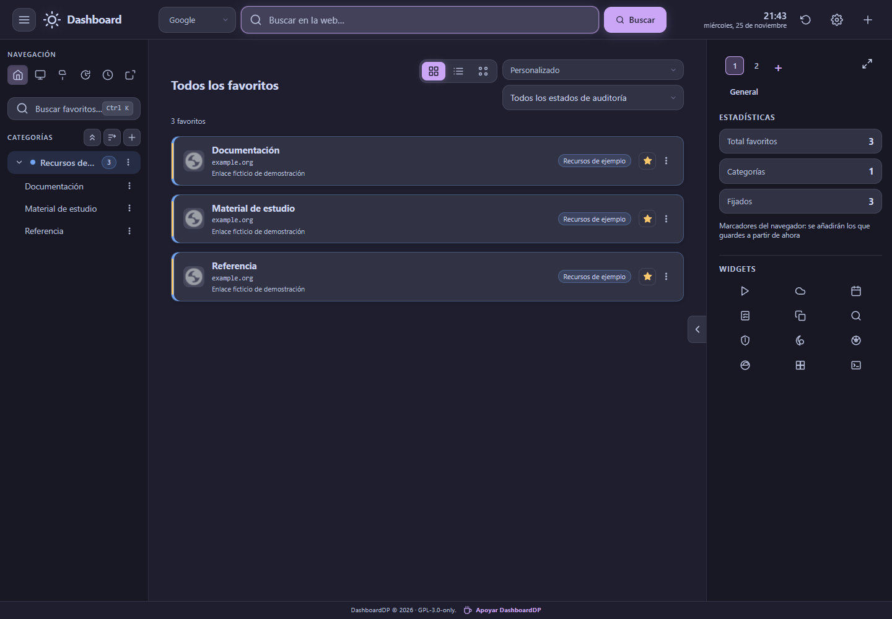
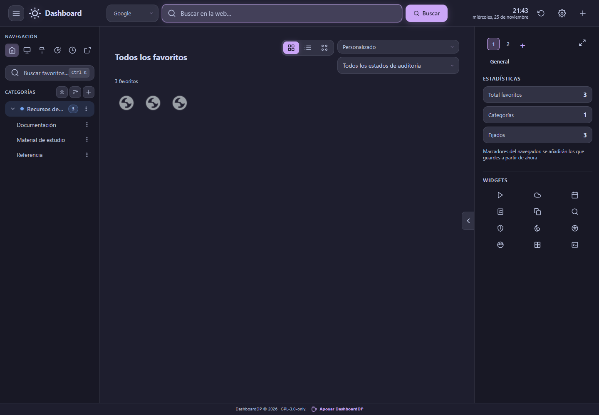
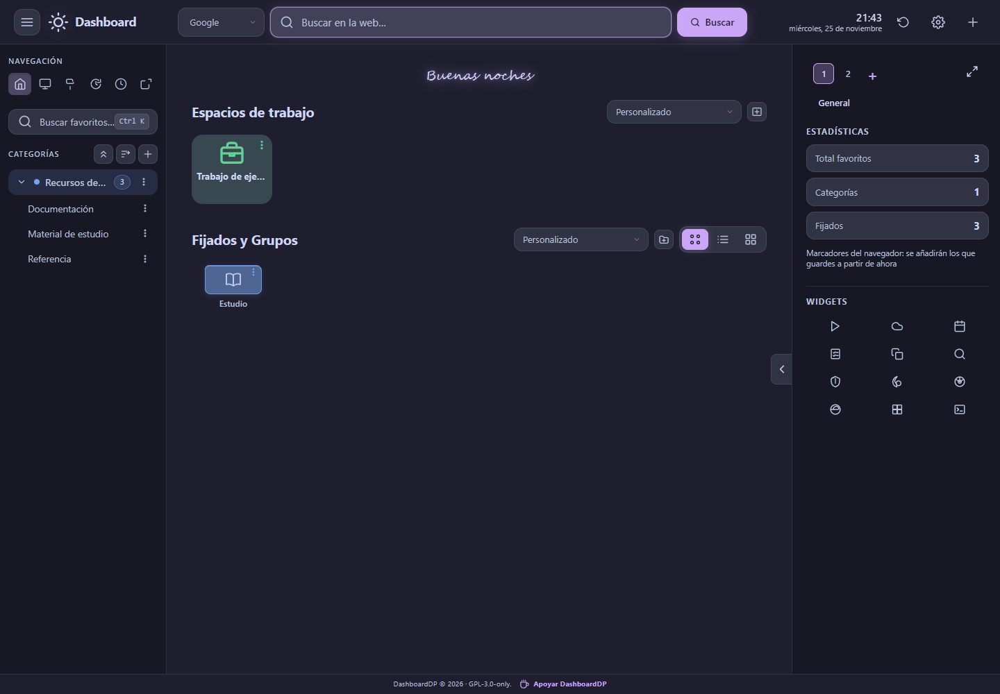
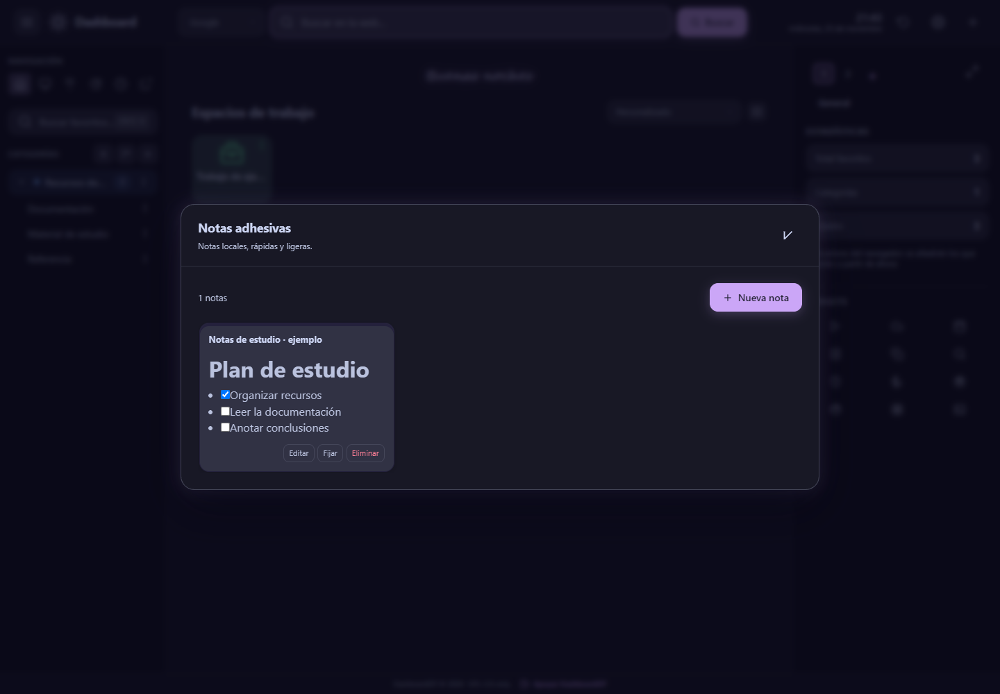
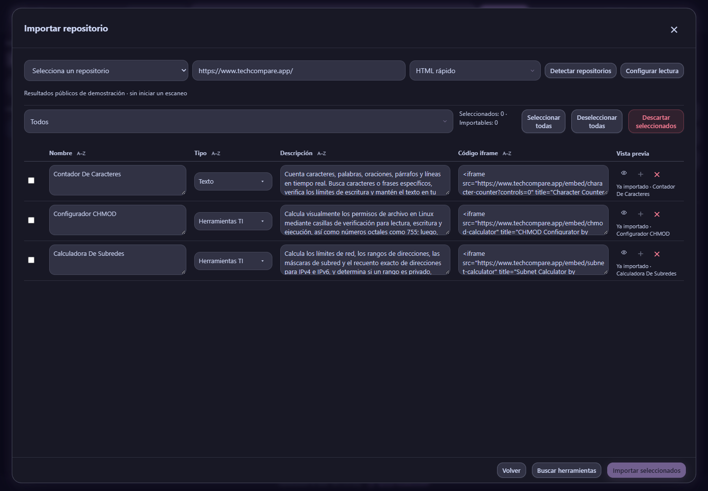
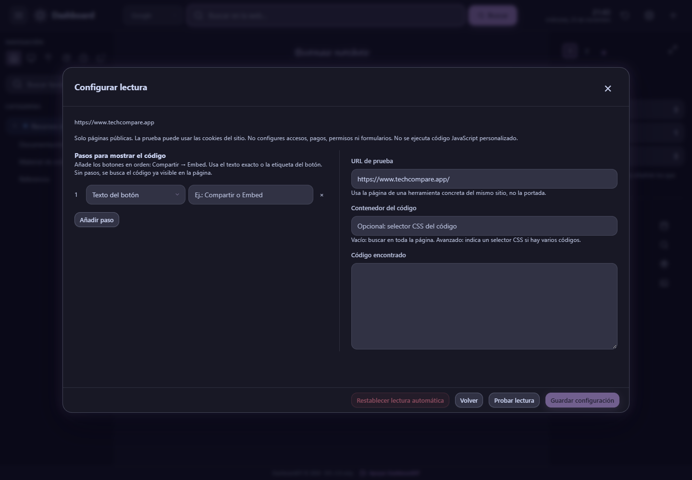
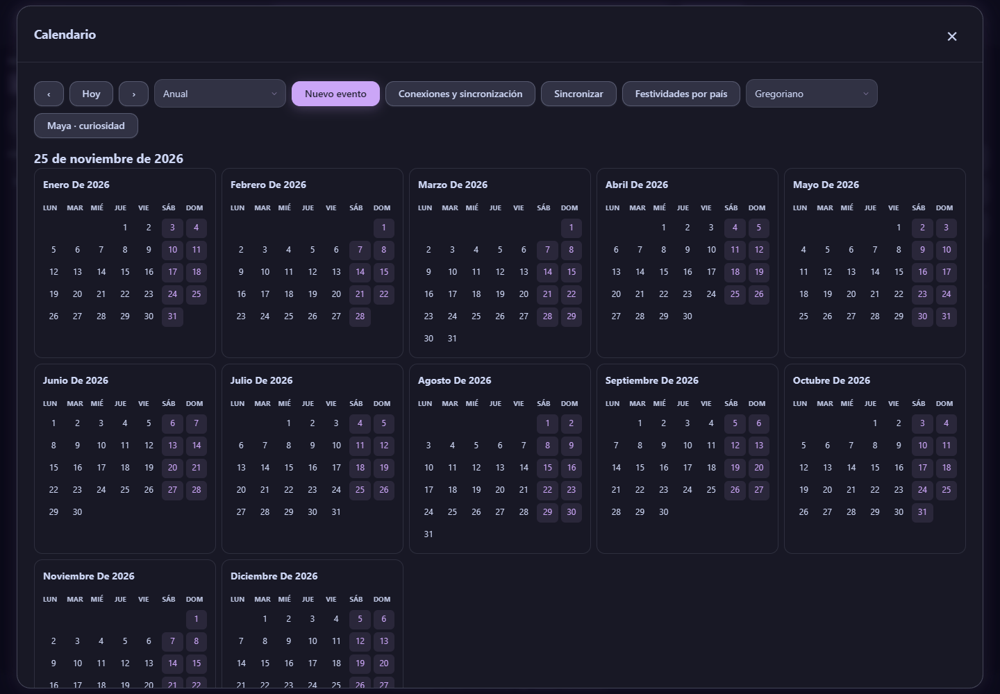

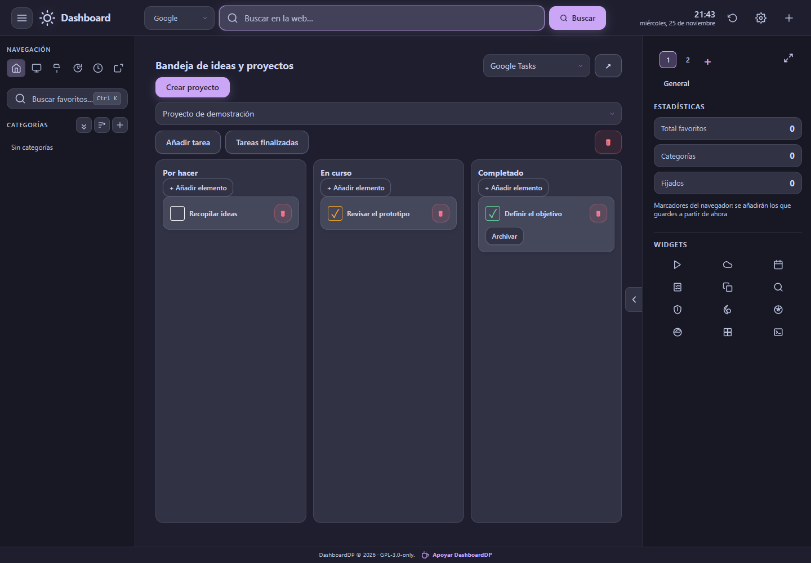

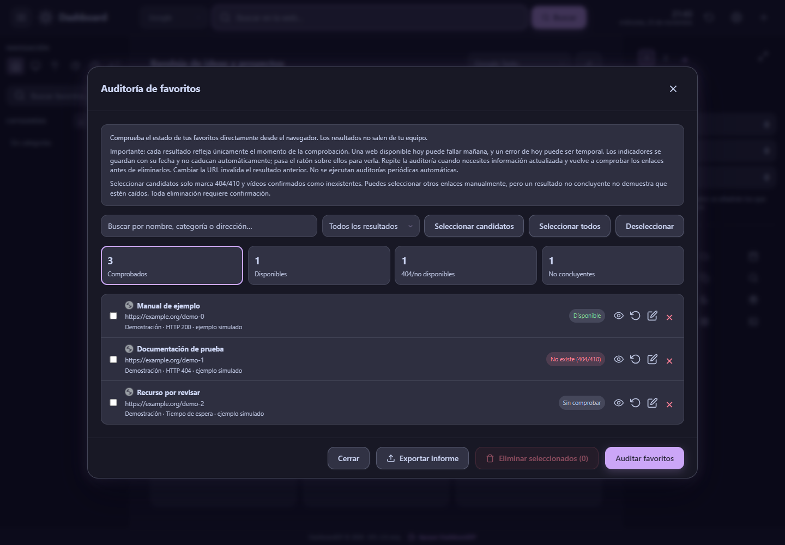
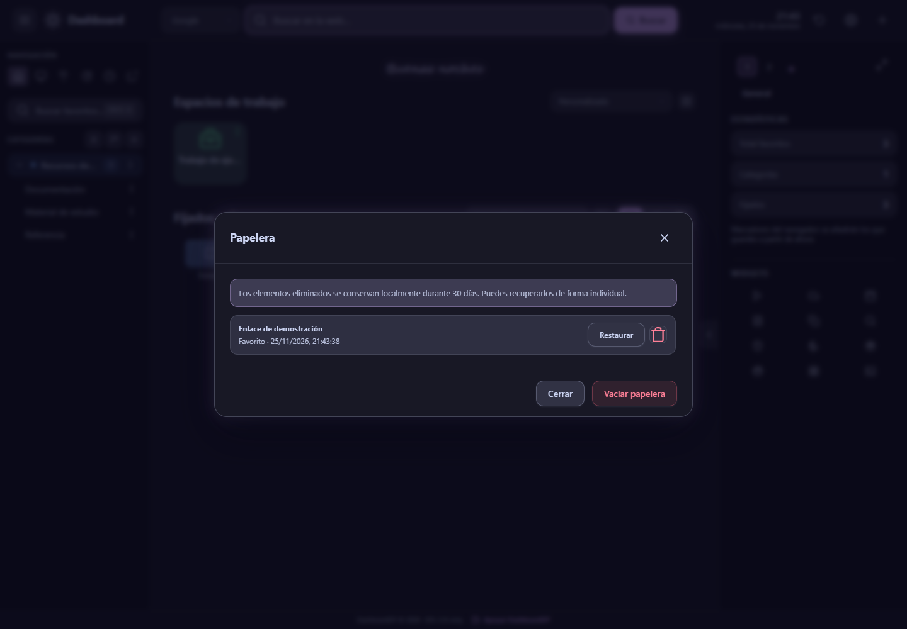

Screenshots use fictional data. Audit results shown here are simulated.

## Privacy and support

DashboardDP has no server of its own. Optional integrations and embedded tools contact their respective providers. Full backups are unencrypted and may contain personal data; store them privately and never attach them to public reports.

Report bugs or suggest improvements in [GitHub Issues](https://github.com/PraenaDP/DashboardDP/issues). Report vulnerabilities through [GitHub's private reporting channel](https://github.com/PraenaDP/DashboardDP/security/advisories/new).

Created by David ([PraenaDP](https://github.com/PraenaDP)). Licensed under [GPL-3.0-only](LICENSE.md). External services retain their own licenses and terms; see the [third-party notices](THIRD-PARTY-NOTICES.md).

[Buy me a coffee on Ko-fi](https://ko-fi.com/K8E42B9WDB/?hidefeed=true&widget=true&embed=true&preview=true) — optional support, with no features locked behind payment.
