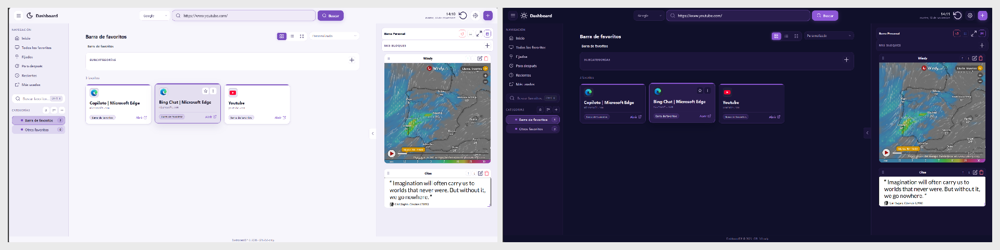

# DashboardDP

DashboardDP es una extensión de nueva pestaña, local y de código abierto, para organizar favoritos, grupos, espacios de trabajo, notas, tareas, widgets y calendarios personales. Es compatible con Brave, Google Chrome y Microsoft Edge en escritorio. Firefox no está soportado por esta versión.

La versión 1.10.48 incorpora correcciones de seguridad. Lee la [auditoría y sus límites](AUDITORIA_SEGURIDAD_2026-09-07.md) antes de distribuir. El estado recomendado es beta controlada, no certificación de seguridad.

## Qué es DashboardDP

DashboardDP convierte la nueva pestaña del navegador en una biblioteca personal y local. Centraliza marcadores, categorías, grupos fijados y espacios de trabajo; añade notas, tareas, widgets y conexiones de calendario opcionales. No requiere una cuenta de DashboardDP ni un servidor propio.

## Vista previa: tema Default



DashboardDP se adapta a modo claro y oscuro y permite cambiar el tema, el color de acento, el fondo, el saludo y la distribución de las barras laterales. Consulta la [galería completa de temas](docs/TEMAS_Y_APARIENCIA.md) para ver **Default**, **Vercelin**, **Youtubin** y **Grafanin**.

## Menús principales

| Área | Para qué sirve |
| --- | --- |
| **Barra superior** | Busca en la web, abre Ajustes, sincroniza el calendario y añade favoritos. |
| **Navegación** | Accede a Inicio, todos los favoritos, fijados, para después, recientes y más usados. |
| **Categorías** | Organiza favoritos y subcategorías; sus etiquetas sirven también como filtros. |
| **Inicio** | Reúne espacios de trabajo, fijados y grupos; admite orden personalizado, por nombre y por fecha. |
| **Panel derecho** | Alterna entre barra estándar y barra personal con widgets, notas visibles e iframes. |
| **Ajustes** | Configura aspecto, búsqueda, sincronización, importación, copias de seguridad, papelera, auditoría y ayuda. |

## Instalación

Consulta el [manual de instalación para Brave, Chrome y Edge](docs/MANUAL_INSTALACION.md). La instalación se hace localmente mediante «Cargar sin empaquetar»; Firefox no debe usar esta versión.

## Flujo de uso desde GitHub

1. Descarga el ZIP de la versión desde GitHub y descomprímelo.
2. Guarda la carpeta de DashboardDP donde prefieras conservarla. Esa carpeta será la instalación local de la extensión.
3. Abre tu navegador y usa **Cargar sin empaquetar** para elegir esa carpeta.
4. Usa el dashboard normalmente, sin necesidad de crear ninguna cuenta.
5. Si quieres sincronizar Google Calendar, sigue la guía personal: crea una credencial OAuth de tipo **Aplicación web**, copia la URI mostrada por DashboardDP y pega tu Client ID en el asistente. No tienes que modificar el `manifest.json`.

La guía completa está en [INTEGRACIONES_CALENDARIO.md](INTEGRACIONES_CALENDARIO.md). Consulta también [PRIVACIDAD.md](PRIVACIDAD.md), [SECURITY.md](SECURITY.md) y el [historial de cambios](CHANGELOG.md) antes de publicar o distribuir una versión.

## Funciones

- Sustituye la nueva pestaña por el dashboard.
- Al instalarse, permite elegir entre integrar los marcadores actuales o empezar de cero y sincronizar solo los nuevos; conserva la estructura de carpetas.
- Permite guardar una página desde el menú contextual.
- Gestiona categorías, etiquetas, pendientes, fijados, grupos y espacios de trabajo.
- En la vista de iconos, cualquier favorito muestra su nombre y dirección web al pasar el ratón o enfocarlo con el teclado, también en Inicio y dentro de los grupos fijados.
- Los iconos manuales tienen prioridad; para el resto, Chromium recupera automáticamente del almacén local del navegador el favicon de mayor resolución disponible (hasta 128 px), con alternativas progresivas al icono publicado por la web y a las iniciales. La dirección del favorito no se envía a servicios externos de iconos.
- Inicio permite ordenar por separado **Fijados y Grupos** y **Espacios de trabajo**: orden personalizado persistente mediante arrastrar y soltar, nombre A–Z/Z–A o fecha de creación en ambos sentidos.
- Incluye un Gestor de tareas Kanban con orden manual por arrastre, orden por fecha o prioridad, propiedades editables desde cada tarjeta, vistas de calendario mensual, semanal y agenda, recordatorios locales, sincronización inteligente incremental e importación/exportación `.ics`.
- El botón circular de la barra superior sincroniza el calendario y permite renovar el acceso sin repetir la configuración cuando Google lo solicite.
- Incluye notas adhesivas locales con formato básico e imágenes optimizadas.
- Las notas marcadas como visibles aparecen al final de la barra estándar y también pueden usarse en la barra personalizada. Cada una recuerda su propia altura: escribe directamente en su título o contenido y arrastra el tirador inferior para redimensionarla. El lápiz conserva el editor completo para formato, imágenes y color. El selector de la cabecera alterna entre una columna y dos columnas tipo masonry; la preferencia se recuerda y cada nota conserva su altura individual.
- Ofrece una barra derecha estándar y otra personal, intercambiables sin perder su configuración. La barra personal admite hasta nueve bloques de Recientes, Estadísticas, Widgets, Notas visibles o iframes propios.
- Los iframes personales aceptan una URL HTTPS o el código `<iframe>` completo. Al editarlos, DashboardDP conserva una versión segura y reutilizable del código, junto con título, ancho y altura; el ancho puede ser un porcentaje o píxeles y nunca se desborda del panel.
- El alta de favoritos puede asignar color propio (paleta, hexadecimal o RGB), grupos de fijados y uno o varios espacios de trabajo desde un único panel legible.
- Puede sincronizarse bidireccionalmente con los marcadores nativos del navegador actual. Desde **Ajustes → Sincronizar con marcadores del navegador** se elige una carpeta de destino y se activa voluntariamente la escritura: crear, editar, mover o eliminar un favorito desde DashboardDP actualiza el navegador; los cambios nativos actualizan DashboardDP.
- Al abrir el calendario compacto de la barra estándar, el panel activa su desplazamiento para mostrar el calendario y las notas sin ocultarlas; al cerrarlo recupera el punto de lectura anterior.
- Mantiene la búsqueda de favoritos junto a las categorías y una búsqueda web destacada en la barra superior, disponible desde cualquier vista. Las sugerencias de búsqueda son opcionales: se activan desde Ajustes y proceden exclusivamente del motor elegido, sin mezclarse con los favoritos locales.
- Abre todos los enlaces de un espacio en pestañas independientes.
- Guarda los datos del usuario localmente en el navegador.
- Permite descargar una **copia completa** del Dashboard y restaurarla en otro equipo: favoritos, categorías, grupos, espacios, tema, fondo, widgets, tareas, eventos y notas. Las conexiones externas se recuperan sin sus sesiones y se renuevan desde el Dashboard.
- Desde **Ajustes → Ayuda → Actualizaciones desde GitHub** permite comprobar voluntariamente la última Release pública. La comprobación pide permiso solo para `api.github.com`, nunca descarga ni sustituye archivos y explica cómo actualizar la misma carpeta de la extensión sin perder los datos locales.
- Incluye una **Papelera** local: favoritos, categorías, grupos, espacios, widgets, tareas y notas eliminados se conservan 30 días. La notificación permite deshacer de inmediato y Ajustes → Datos → Revisión y mantenimiento permite restaurarlos individualmente.
- Incluye un asistente para reunir marcadores de Brave, Google Chrome, Microsoft Edge, Mozilla Firefox, Vivaldi, Opera, Safari u otro navegador. Exporta los marcadores a HTML desde cada navegador y usa **Ajustes → Importar desde otro navegador**: cada archivo se integra sin borrar los que ya tengas.

## Unificar favoritos de varios navegadores

Instala DashboardDP en el navegador que vayas a usar como biblioteca principal. Desde ahí, entra en **Ajustes → Importar desde otro navegador**, elige el navegador de origen y sigue sus tres pasos para exportar un archivo HTML. Repite la importación con cada navegador que quieras reunir. Por defecto, cada origen queda ordenado dentro de su propia categoría `Importado · Nombre del navegador`; puedes desactivar esa opción si prefieres mezclarlo directamente con tus categorías.

DashboardDP no puede ni debe leer directamente los perfiles de los otros navegadores. El archivo HTML lo eliges tú y la vista previa te indica cuántos favoritos se añadirán. Al terminar, descarga una **copia completa**: podrás restaurarla en otra instalación local de DashboardDP si cambias de equipo o de navegador.

## Marcadores bidireccionales

La sincronización bidireccional se configura de forma independiente en cada navegador. Elige una carpeta nativa de destino antes de activarla; DashboardDP creará dentro las categorías que necesite. Puedes usar **Copiar favoritos actuales al navegador** una sola vez para publicar en esa carpeta los favoritos locales que aún no estén vinculados.

Las altas, ediciones, movimientos y eliminaciones hechas desde el gestor de marcadores del navegador generan un aviso persistente para DashboardDP. El cambio se aplica aunque el proceso en segundo plano haya estado suspendido, y se vuelve a comprobar al regresar a la pestaña. Si una sincronización ya estaba en curso, la siguiente queda en cola en lugar de perderse.

No es una sincronización automática entre Brave, Edge, Firefox o Chrome: cada navegador protege su perfil de forma independiente. Para trasladar tu biblioteca completa entre navegadores o equipos, utiliza la copia completa de DashboardDP.

## Instalar localmente

### Brave, Chrome o Edge

1. Abre `brave://extensions`, `chrome://extensions` o `edge://extensions`.
2. Activa **Modo desarrollador**.
3. Pulsa **Cargar sin empaquetar**.
4. Selecciona esta carpeta: la que contiene este archivo y `manifest.json`.
5. Abre una nueva pestaña.

### Firefox

Firefox **no es compatible** con esta versión. No cargues esta carpeta como extensión de Firefox: antes haría falta adaptar y validar el manifiesto, el proceso de fondo, los permisos, las integraciones y la distribución de Mozilla.

## Distribuir desde GitHub

Este directorio completo es el repositorio. Se distribuye como descarga para instalación local; no requiere GitHub Pages, una tienda de extensiones ni una cuenta central de DashboardDP. No incluyas copias de seguridad JSON, exportaciones HTML ni datos personales.

```powershell
git init
git add .
git commit -m "Initial release"
```

Después crea un repositorio vacío en GitHub y conéctalo siguiendo las instrucciones que muestra GitHub. Para los usuarios, ofrece el ZIP de una versión en la sección **Releases**: deben descomprimirlo en una carpeta que conservarán y seguir «Instalar para probar».

## Privacidad

La extensión solicita permisos de marcadores para detectar altas, cambios, movimientos y borrados; y de alarmas y notificaciones únicamente para mostrar recordatorios de tareas. Los datos del dashboard se guardan localmente en el navegador; la extensión no envía los marcadores ni las tareas a un servidor propio. Si se activan las sugerencias de búsqueda web en Ajustes, el navegador pedirá permiso para comunicarse solo con el buscador seleccionado; únicamente se envía el texto que la persona escribe para recibir propuestas.

La conexión personal de Google Calendar y Outlook/Microsoft 365 está explicada paso a paso en [INTEGRACIONES_CALENDARIO.md](INTEGRACIONES_CALENDARIO.md). No incluyas secretos, contraseñas ni archivos de credenciales en el repositorio.

Los widgets personales son opcionales: DashboardDP solo carga la URL HTTPS que indique quien utiliza la extensión dentro de un iframe aislado. Algunos servicios impiden ser mostrados de esta forma. Revisa siempre la procedencia y las condiciones del servicio antes de añadirlo. La **Biblioteca de widgets**, accesible desde el selector de añadir bloque y desde **Ajustes → Datos**, guarda localmente cada iframe creado o editado. Puedes recuperar un widget eliminado de la barra, conservar versiones alternativas y copiar su código. Quitar un bloque no lo elimina de la biblioteca; solo el borrado explícito de la entrada lo hace. La instalación limpia no contiene URLs ni widgets personales.

La pestaña **Ajustes → Datos** organiza sus acciones por finalidad: **Marcadores del navegador** (sincronizar, importar y exportar HTML), **Copias y restauración** (guardar o recuperar el estado completo), **Revisión y mantenimiento** (auditoría y revisión de biblioteca), **Widgets guardados** y una **Zona de peligro** separada para el restablecimiento. Antes de restaurar o restablecer, descarga una copia completa.

La Papelera viaja en la copia completa y conserva hasta 250 entradas durante un máximo de 30 días; las antiguas pueden caducar antes al alcanzar el límite. Restaurar un favorito recupera sus pertenencias a grupos y espacios existentes. Con escritura nativa activa, recrea el marcador en la carpeta configurada. Vaciar Papelera pide confirmación; también existe eliminación definitiva individual y caducidad.

Al restaurar una copia completa se eliminan los vínculos nativos del perfil de origen y se desactiva la escritura: vuelve a elegir la carpeta de destino desde Ajustes antes de sincronizar. Las importaciones de archivos se limitan a 25 MB y rechazan estructuras incorrectas y categorías circulares.

### Auditoría de disponibilidad de favoritos

En **Ajustes → Datos → Auditar disponibilidad de favoritos** se puede revisar toda la biblioteca sin enviarla a un servidor de DashboardDP. La extensión solicita permiso opcional para consultar direcciones HTTP/HTTPS únicamente cuando la persona inicia la auditoría.

- Distingue páginas disponibles, HTTP 404/410, vídeos de YouTube no disponibles, accesos protegidos, errores temporales del servidor, tiempos de espera y fallos de red.
- Al finalizar, guarda automáticamente el último resultado en cada favorito. En las vistas de tarjetas y lista aparece una insignia compacta junto a la categoría: ✅ disponible, `404`, `YT×`, 🔒 protegido, 🚨 servidor, ⌛ espera, 📡 red o `⌂` local/especial. Su leyenda muestra el detalle y la fecha al pasar el ratón.
- La insignia es informativa e independiente de la selección para borrar. Si se modifica la dirección del favorito, se descarta el resultado anterior hasta volver a auditarlo.
- Las insignias son clicables: al pulsarlas se abre un listado exacto de todos los favoritos con ese mismo estado auditado. Las etiquetas de categoría también se pueden pulsar para abrir todos los enlaces de esa categoría. Ninguna de estas acciones abre accidentalmente la web de la tarjeta.
- Los fallos de DNS, TLS, ISP, VPN, autenticación y tiempo de espera son resultados no concluyentes y nunca se preseleccionan para borrar.
- Las direcciones privadas reconocidas se omiten. Las redirecciones requieren revisión manual y se clasifican como restringidas. Un dominio puede resolver a una dirección privada: esta protección no garantiza aislamiento de red.
- El informe completo se descarga en Markdown.
- Para no saturar el navegador en bibliotecas grandes, la auditoría usa un número limitado de comprobaciones simultáneas y muestra los resultados por bloques de 160; el botón «Mostrar resultados más» carga el siguiente tramo cuando lo necesitas.
- La eliminación siempre requiere selección y confirmación explícitas. Solo son seleccionables como candidatos los 404/410 y vídeos confirmados como inexistentes.
- Con la sincronización bidireccional activa, se elimina también el marcador nativo vinculado. Si ese borrado falla, DashboardDP conserva el favorito para evitar que ambas bibliotecas diverjan.

El selector general de orden ofrece modo personalizado, nombre A–Z/Z–A, uso mayor/menor y último acceso reciente/antiguo.

## Ayuda, cambios y especificación

El menú **Ajustes → Ayuda y guía de uso** es una guía operativa: organiza las funciones por área e indica dónde está cada control, qué botón o icono hay que pulsar, los pasos, el resultado esperado y los límites o permisos relevantes. La referencia funcional para mantener el proyecto está en [ESPECIFICACION.md](ESPECIFICACION.md).

**Regla obligatoria de mantenimiento:** ninguna función, botón, icono, selector, atajo o cambio visible se considera terminado hasta que su forma de uso esté descrita y comprobada en la Ayuda integrada, la especificación y, cuando afecte a la capacidad pública, este README. La comprobación debe poder completarse siguiendo la ayuda sin conocimiento previo.

### Comprobación previa a una versión

Antes de crear una copia para publicar, ejecuta desde PowerShell:

```powershell
powershell -NoProfile -ExecutionPolicy Bypass -File .\tools\verify-extension.ps1
```

La comprobación revisa sintaxis y declaraciones estáticas; no demuestra por sí sola el comportamiento seguro. Para pruebas dinámicas con datos ficticios, Node.js y Playwright, ejecuta `node tools/security-regression.cjs . RUTA_DE_RESULTADOS`. Consulta alcance y pendientes en el informe de auditoría.

## Apoyar el proyecto

DashboardDP es gratuito y no contiene publicidad, telemetría ni funciones bloqueadas por pago. Si quieres colaborar con su mantenimiento, el enlace oficial de Ko-fi se muestra de forma discreta en **Ajustes → Ayuda → Acerca de DashboardDP** y en el pie del Dashboard cuando el autor lo haya configurado.

La donación es voluntaria, abre Ko-fi en una pestaña externa y no comparte favoritos, notas, tareas, calendario ni ningún dato de DashboardDP. La cuenta de Ko-fi pertenece exclusivamente al autor; los usuarios no pueden cambiar el destino desde sus ajustes. Consulta [SUPPORT.md](SUPPORT.md) antes de configurar una versión pública.

## Créditos y licencia

DashboardDP está dirigido, revisado y publicado por David ([@PraenaDP](https://github.com/PraenaDP)) con asistencia de herramientas de IA generativa. La responsabilidad sobre las decisiones de producto, pruebas y publicación corresponde al autor.

El código se distribuye bajo [GPL-3.0-only](LICENSE.md). Puedes usarlo, estudiarlo, modificarlo y redistribuirlo; si distribuyes una versión modificada o derivada, debe conservar GPLv3 y ofrecer el código fuente correspondiente. Esta licencia no prohíbe el uso comercial, pero impide convertir las versiones derivadas distribuidas en software propietario.
