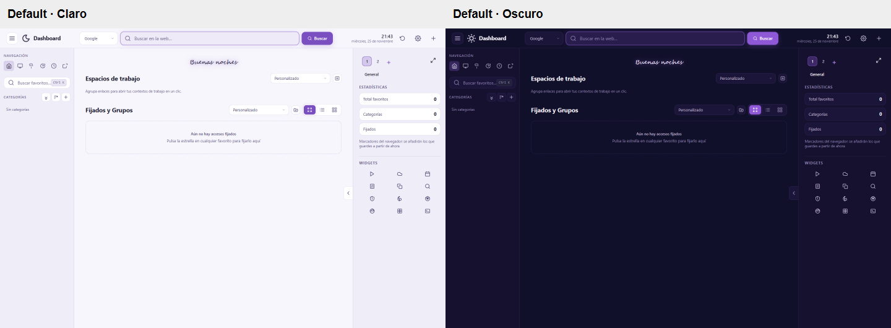
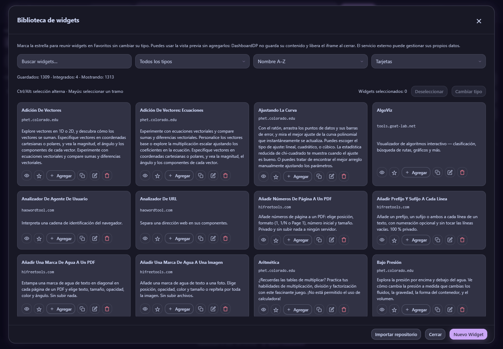
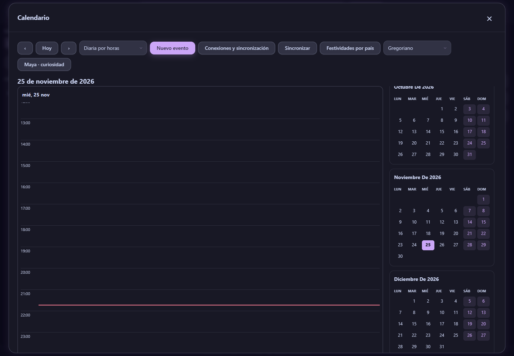
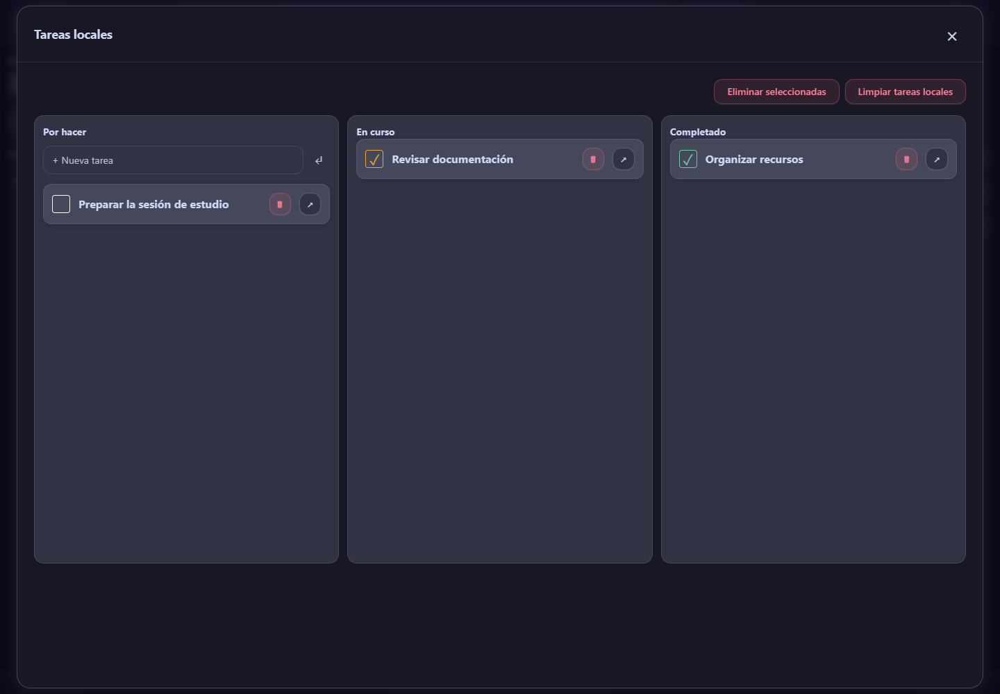
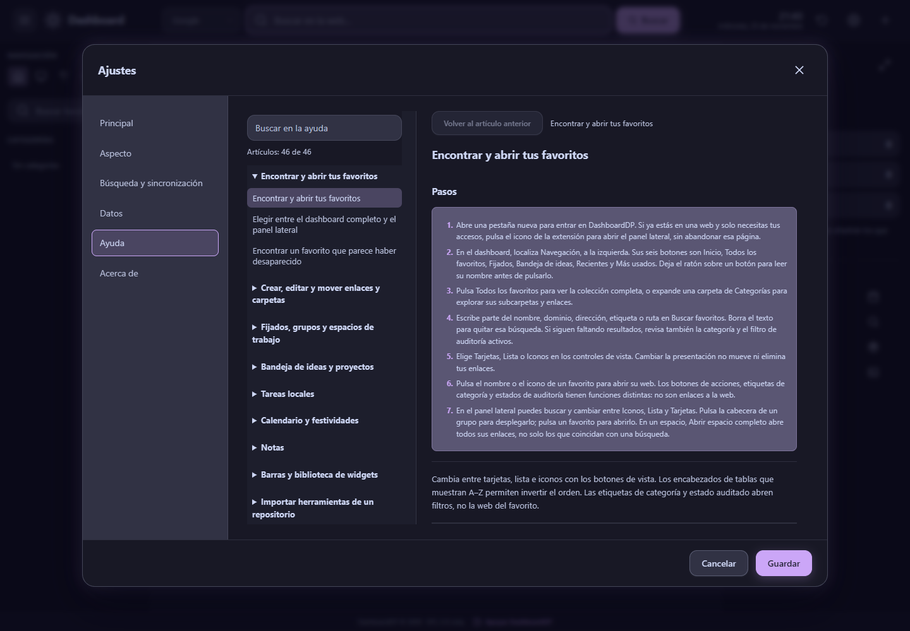
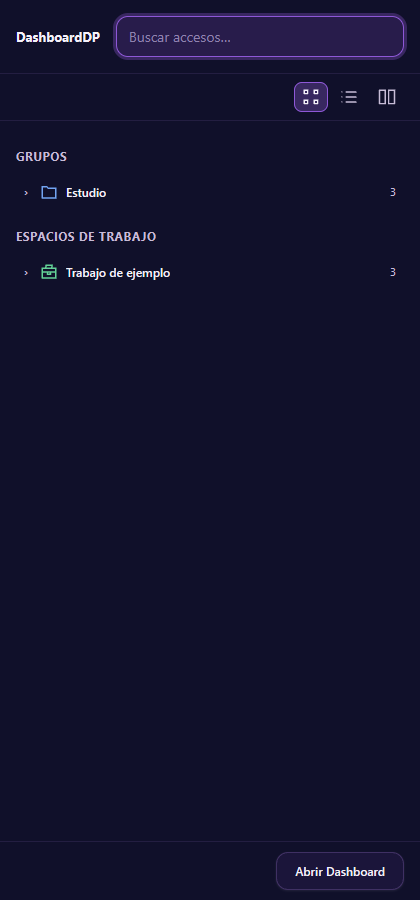

# DashboardDP

El icono de la extensión abre un panel lateral con fijados, grupos y espacios de trabajo junto a la página actual, sin crear una pestaña del dashboard. Incluye búsqueda y apertura explícita de enlaces o espacios completos. El navegador controla el lado y el ancho del panel. «Abrir Dashboard» sigue disponible como acción manual.

El selector superior permite alternar entre Iconos, Lista y Tarjetas. La vista del panel se recuerda por separado de la vista del dashboard; inicialmente utiliza la vista de Fijados configurada allí. Los grupos se despliegan sin abrir sus enlaces y la búsqueda funciona en las tres vistas.

Tu nueva pestaña para organizar favoritos, espacios de trabajo, proyectos, notas, tareas, widgets y calendarios. Funciona localmente en Brave, Google Chrome y Microsoft Edge de escritorio, sin cuenta de DashboardDP. Firefox todavía no es compatible.

## Capturas de DashboardDP

Inicio limpio con el tema Default en modo claro y oscuro:

Biblioteca pública de widgets, sin cargar todas las herramientas a la vez:

Ver temas, calendario, proyectos, tareas, ayuda y auditoría

Las pantallas con favoritos, notas, tareas, proyectos, papelera y auditoría utilizan datos ficticios de demostración. Los estados de la auditoría son simulados, no comprobaciones de sitios reales. La captura del panel lateral muestra su contenido a 420 px; el navegador controla su posición y tamaño al acoplarlo.

## Instalar DashboardDP

1. Descarga el ZIP de una versión publicada en [Releases](https://github.com/PraenaDP/DashboardDP/releases).
2. Descomprímelo en una carpeta permanente.
3. Abre `brave://extensions`, `chrome://extensions` o `edge://extensions`.
4. Activa **Modo desarrollador**, pulsa **Cargar sin empaquetar** y selecciona la carpeta que contiene `manifest.json`.
5. Abre una nueva pestaña y elige si deseas incorporar los marcadores del navegador.

No necesitas Git, una terminal ni un servidor. Consulta el [manual de instalación y actualización](docs/MANUAL_INSTALACION.md).

## Qué puedes hacer

- Organizar favoritos y carpetas desde el explorador, con menús de tres puntos y movimiento por arrastre.
- Abrir tus contextos mediante espacios de trabajo, fijados y grupos.
- Gestionar ideas, proyectos, tareas locales y notas.
- Usar hasta nueve barras laterales: la primera fija, la segunda dedicada inicialmente a notas y las siguientes personalizables.
- Guardar widgets con búsqueda, tipos, favoritos, tabla, tarjetas y vistas previas bajo demanda.
- Explorar repositorios públicos de iframes, revisar coincidencias y reanudar búsquedas. Los ya importados se pueden descartar de los resultados, pero no reimportar.
- Auditar favoritos, revisar el último estado, corregir sus datos y volver a comprobarlos.
- Consultar calendarios, conectar Google Calendar o Microsoft 365 y añadir festividades por país opcionalmente.
- Elegir temas claros y oscuros, fondo, tipografía e idioma.

La [guía por tareas en español](docs/GUIA_DE_USO.md) y la [English user guide](docs/USER_GUIDE.md) explican el recorrido paso a paso. Ese mismo contenido está integrado en **Ajustes → Ayuda**, con buscador e índice por temas; la información del proyecto está en **Ajustes → Acerca de**.

## Actualizar sin perder tus datos

Descarga primero una **Copia completa** desde **Ajustes → Datos** y guárdala fuera de la carpeta de DashboardDP. Cierra las pestañas del dashboard, sustituye los archivos de la extensión en **la misma carpeta** por los de la nueva versión y pulsa **Recargar** en la página de extensiones.

No desinstales ni cargues una segunda carpeta para actualizar. Los datos están en el perfil del navegador, no en el ZIP. Cambiar de navegador, perfil o ubicación puede exigir restaurar la copia y volver a autorizar las conexiones.

## Tus datos y tu biblioteca

La copia completa conserva personalización, favoritos, grupos, espacios, notas, tareas, proyectos, biblioteca y papelera. Es un JSON **sin cifrar**: guárdalo en una ubicación privada, con una segunda copia externa o versionada. No lo adjuntes a incidencias ni lo subas al repositorio.

Exporta después de cambios importantes y antes de actualizar, restaurar, restablecer o desinstalar. Una carpeta sincronizada puede servir de respaldo, pero no sustituye el historial de versiones ni la comprobación de restauración.

Quitar un widget de una barra no borra su entrada en la biblioteca. Descartar un resultado de importación tampoco borra el widget ya guardado. La papelera es temporal, no una copia de seguridad.

## Conexiones y límites

DashboardDP no envía tu biblioteca a un servidor propio. Los servicios que activas reciben las solicitudes necesarias: widgets, meteorología, favoritos auditados, sugerencias, calendarios o festividades. Algunos iframes bloquean su incrustación o requieren permisos; cambiar de idioma no traduce el contenido de una web externa.

Las traducciones disponibles se guardan localmente. Si editas un campo personal, se conserva tu texto y no se sustituye por una traducción antigua. Un campo sin traducción revisada muestra el original.

Consulta [Privacidad](PRIVACIDAD.md), [Seguridad](SECURITY.md), [Conexiones de calendario](INTEGRACIONES_CALENDARIO.md) y [Cambios](CHANGELOG.md). Esta distribución de escritorio sigue en evolución: no es una certificación de seguridad ni una publicación aprobada por Chrome Web Store.

## Ayudar a mejorar DashboardDP

Puedes [informar de un error o proponer una mejora](https://github.com/PraenaDP/DashboardDP/issues). Explica los pasos y el resultado esperado sin adjuntar información privada. No necesitas preparar código ni instalar herramientas de desarrollo para colaborar.

## Acerca de

Creado por David · [Perfil de PraenaDP](https://github.com/PraenaDP).

DashboardDP se distribuye bajo [GPL-3.0-only](LICENSE.md). La orientación al uso de esta guía no restringe los derechos de copia, estudio, modificación y redistribución de la licencia. Las marcas, servicios y recursos de terceros conservan sus condiciones y [atribuciones](THIRD-PARTY-NOTICES.md).

El apoyo es voluntario y no desbloquea ni limita funciones. El botón abre el panel de donación, no el perfil del autor. En **Ajustes → Acerca de** se muestra dentro de DashboardDP; GitHub no ejecuta widgets JavaScript en el README, por lo que utiliza el botón gráfico enlazado al panel.
