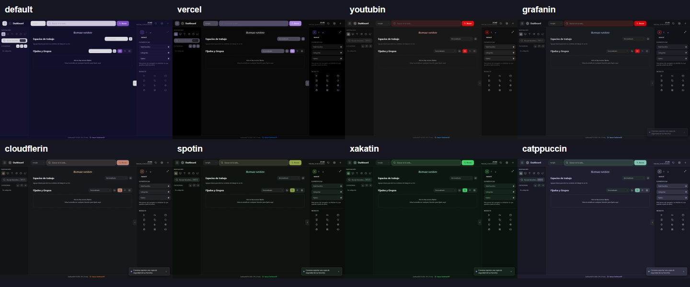
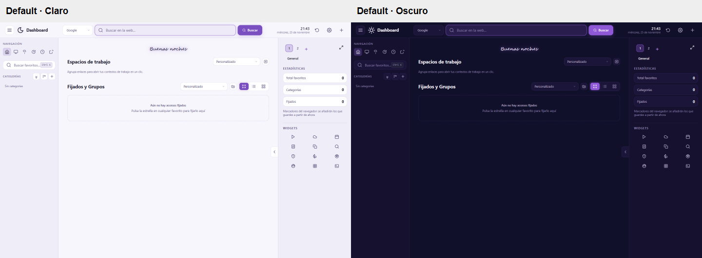

# Themes and appearance

DashboardDP includes Default, Vercelin, Youtubin, Grafanin, Cloudflerin, Spotin, Xakatin, and Catppuccin, each with light and dark modes.

Open **Settings → Appearance**, choose a theme and color mode, preview the background, select a locally installed font, and save. See the [appearance chapter](USER_GUIDE.md#11-appearance-fonts-and-languages) for details.

The screenshots contain no private data. See [third-party notices](../THIRD-PARTY-NOTICES.md) for licenses and attribution.
