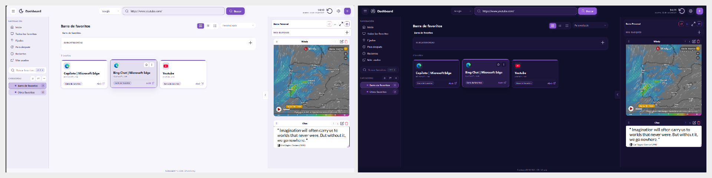

# Temas y apariencia

DashboardDP permite personalizar la apariencia sin enviar ninguna configuración a un servidor. Los cambios se guardan en el perfil local del navegador y se pueden incluir en una copia completa.

Cada comparativa de esta página usa capturas reales de la instalación limpia: **modo claro a la izquierda** y **modo oscuro a la derecha**.

## Morado clásico

## Azul

## Monocromo

## Qué se puede ajustar

| Ajuste | Dónde se cambia | Resultado |
| --- | --- | --- |
| Modo claro u oscuro | **Ajustes → Aspecto** | Cambia los fondos, bordes, textos y controles de toda la interfaz. |
| Color de acento | **Ajustes → Aspecto** | Personaliza botones, foco, etiquetas y elementos seleccionados. |
| Fondo del dashboard | **Ajustes → Aspecto** | Permite usar color o imagen y regular la opacidad para conservar la legibilidad. |
| Saludo de Inicio | **Ajustes → Aspecto** | Se puede mostrar u ocultar, elegir fuente y modificar su tamaño. |
| Barra derecha estándar o personal | Control de la barra derecha | Cada barra recuerda su propia distribución y tipo de vista. |
| Vistas de favoritos | Selector situado en cada listado | Alterna tarjetas, lista o iconos; cada sección conserva su preferencia. |
| Barra personal | Controles de su cabecera | Admite bloques, widgets, notas e iframes y puede reorganizarse sin afectar a la barra estándar. |

> Las capturas sirven como referencia visual. Las integraciones externas, las notas y los widgets son opcionales; la instalación limpia no incluye datos personales ni credenciales.
