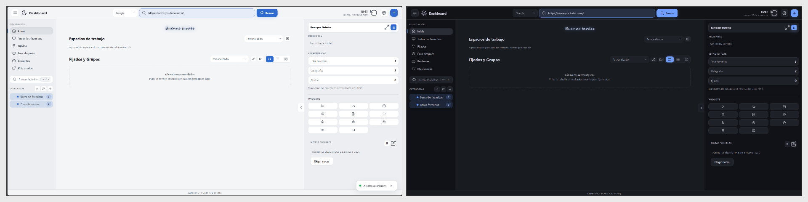
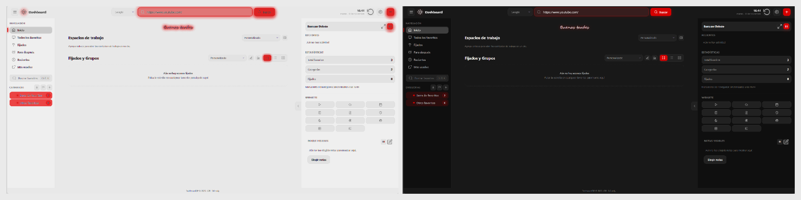
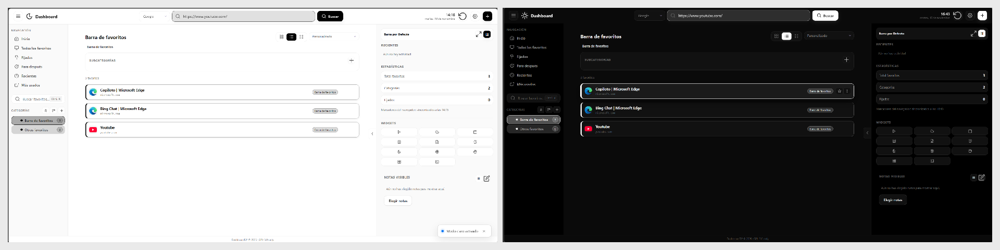

# Galería de temas

DashboardDP incluye cuatro temas de referencia. Cada imagen compara el mismo tema en **modo claro a la izquierda** y **modo oscuro a la derecha**.

## Default

## Vercelin

## Youtubin

## Grafanin

## Personalización visual

| Ajuste | Dónde se cambia | Resultado |
| --- | --- | --- |
| Tema | **Ajustes → Aspecto** | Selecciona Default, Vercelin, Youtubin o Grafanin. |
| Modo claro u oscuro | **Ajustes → Aspecto** | Ajusta fondos, bordes, textos y controles a la luminosidad elegida. |
| Color de acento | **Ajustes → Aspecto** | Personaliza botones, foco, etiquetas y elementos seleccionados. |
| Fondo del dashboard | **Ajustes → Aspecto** | Permite usar color o imagen y regular la opacidad para conservar la legibilidad. |
| Saludo de Inicio | **Ajustes → Aspecto** | Se puede mostrar u ocultar, elegir fuente y modificar su tamaño. |
| Vistas de favoritos | Selector situado en cada listado | Alterna tarjetas, lista o iconos; cada sección conserva su preferencia. |
| Barra derecha | Control de la barra derecha | Alterna barra estándar o personal; cada una recuerda su propia disposición. |

> Las muestras usan una instalación limpia de DashboardDP. No incluyen favoritos, notas, widgets ni credenciales personales.
